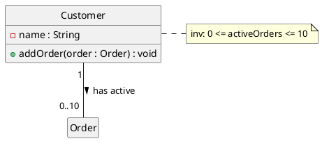
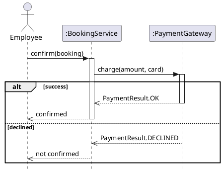
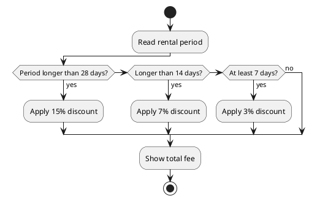
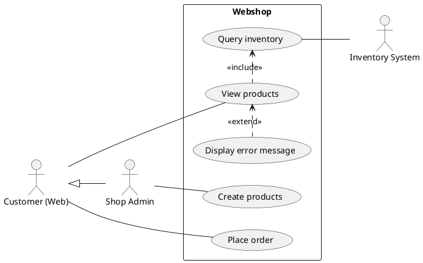
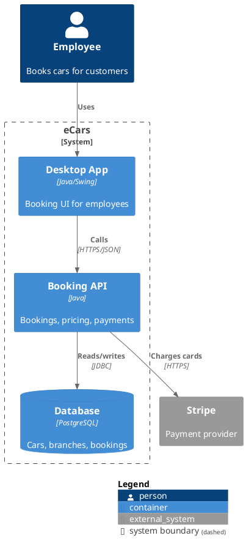
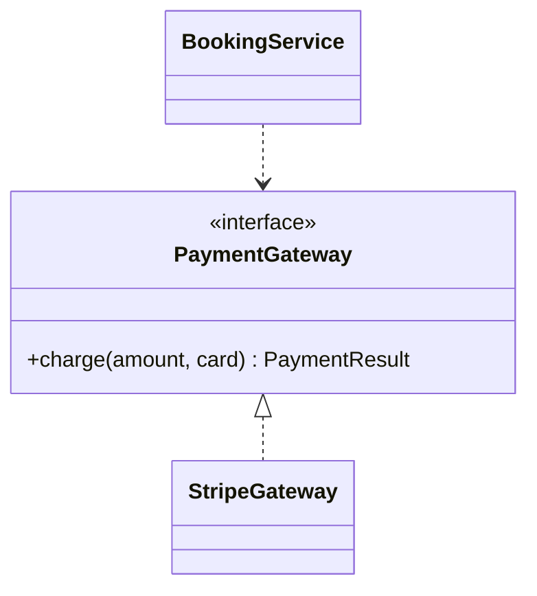
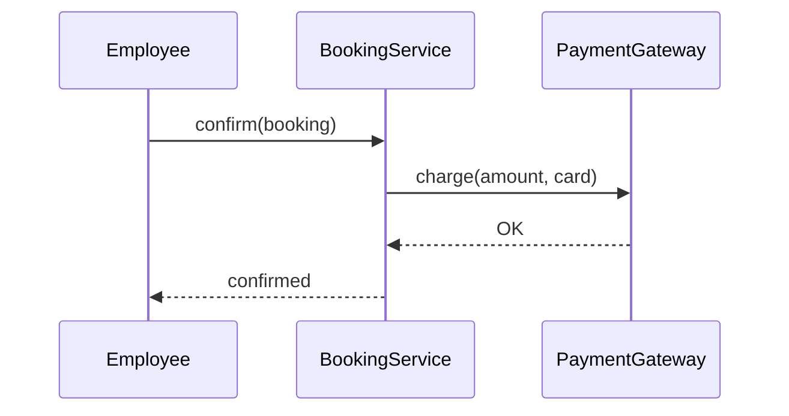

# UML and C4 with PlantUML (and Mermaid)

Use text-based diagrams so they can be versioned, diffed and rendered in CI.
Useful PlantUML settings:

```
skinparam style strictuml   ' UML 2 style
skinparam linetype ortho    ' straight lines (not for use case diagrams)
hide empty members          ' class diagrams
autoactivate on             ' sequence diagrams: activation bars
```

## Class diagram

Conventions: getters/setters are not modelled (attributes assumed readable and
writable unless marked `{readOnly}`); types after a colon.

| Concept | PlantUML |
|---|---|
| Class with members | `class Rental {\n - days : int\n + fee() : Money\n}` |
| Visibility | `-` private, `~` package, `#` protected, `+` public |
| Static / abstract | `{static} counter : int`, `abstract class Base`, `{abstract} start()` |
| Interface | `interface PaymentGateway <<interface>>` |
| Association (+ label) | `Customer - Order : > places` |
| Multiplicity | `Customer "1" - "0..10" Order` |
| Aggregation (part-of, may exist alone) | `Team o-- Player` |
| Composition (part-of, lifetime bound) | `Order *-- "1..*" OrderItem` |
| Generalisation | `Vehicle <|-- Car` |
| Realisation | `PaymentGateway <|.. StripeGateway` |
| Dependency (uses) | `BookingService ..> PaymentGateway : <<use>>` |
| Note | `note right of Rental::days\n invariant: days >= 1\nend note` |



## Component diagram

A component encapsulates its content, is replaceable, and is defined by provided
and required interfaces; implementations should be independently deployable.

```plantuml
@startuml
component Booking
component Payment
component StripeAdapter
interface PaymentGateway
Payment - PaymentGateway        ' provides (lollipop)
Booking ..> PaymentGateway      ' requires
StripeAdapter ..|> PaymentGateway
@enduml
```

Prefer provided/required interfaces (lollipop) over plain dependency arrows once
the interface is known.

## Sequence diagram



Lifelines belong to objects (`:Class`). Fragments: `alt/else`, `opt`, `loop` – use
sparingly; two diagrams are often clearer than nested fragments. Create:
`create participant X` / `A -> "X" ** : new`; destroy: `destroy X` or `A ->> X !!`.

## Activity (control flow) diagram

Write actions in plain language, not code.



Loops: `while (Hospital has capacity and patients waiting?)` … `endwhile`;
`repeat` … `repeat while (...)`; `switch (x?)` / `case (a)` / `endswitch`;
`break` to leave a loop; `end` for a flow final in concurrent flows.

## Use case diagram



Rules: associations only actor ↔ use case; include = always executed; extend =
optional (condition as note); generalisation between actors (OR) or between use
cases; included use cases are connected to an actor only if they can run on their
own.

## C4 with PlantUML (C4-PlantUML)



## Mermaid equivalents (render natively on GitHub/GitLab)




